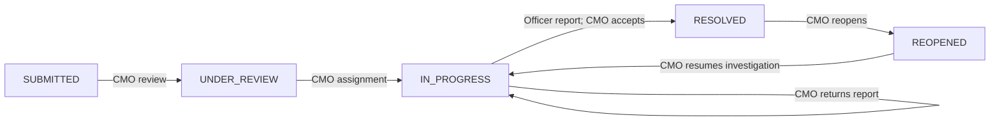

# Project Overview

## Problem and objectives

Grievances are difficult to coordinate when submissions, departmental investigation and final decisions are tracked separately. This prototype brings those activities into one auditable workflow while protecting citizen information.

The objectives are to provide clear case references and progress visibility, enforce departmental responsibility, keep resolution under CMO control, and offer optional AI recommendations without making submission dependent on an external provider.

## Scope and roles

| Role | Responsibilities |
| --- | --- |
| Public visitor | Read published information, browse active departments/FAQs, send a contact enquiry |
| Citizen | Register, submit and track own grievances, view public updates/history, attach evidence when configured, give eligible feedback |
| CMO administrator | Review all grievances, set priority, assign/reassign departments and officers, escalate, review reports, resolve/reopen, inspect analytics and manage public content |
| Department officer | Read currently assigned department cases; modify only cases allowed by the active hybrid assignment; submit updates and reports |

The implemented application includes a navy/teal React interface, role-specific dashboards, server-side filtering and pagination, private evidence metadata, feedback per resolution cycle, public content management, and Gemini advisory interfaces. The API—not the interface—enforces ownership and role boundaries.

## Grievance lifecycle

Priorities are exactly `LOW`, `MEDIUM` and `HIGH`. Report states are `PENDING`, `ACCEPTED` and `RETURNED`; they are not extra grievance statuses. Submitting a report never resolves a case. Every status transition records history in the same transaction. Reassignment and reopening preserve previous investigations and reports.

## Boundaries

This is an independent WhiteMatrix recruitment demonstration, not a government service. It has no government identity verification, guaranteed service-level agreement, autonomous AI decisions, bulk embedding backfill or public grievance lookup. Tracking requires authentication and authorized ownership. AI and Storage are optional integrations; mocked tests do not establish hosted availability.
