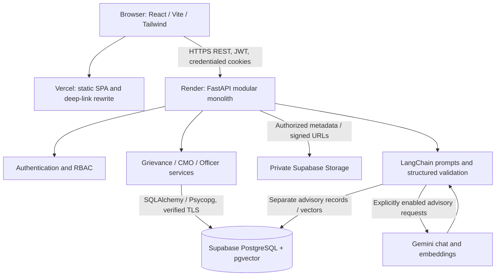

# System Architecture

## Components

One React/Vite application contains public, Citizen, CMO and Officer route groups. Shared layouts, Tailwind styling and API services preserve a consistent interface. Axios sends credentialed REST requests to `/api/v1`; bearer access tokens stay in memory.

FastAPI is a synchronous modular monolith. Domain routers validate Pydantic schemas; services enforce business rules and transaction boundaries; repositories perform scoped SQLAlchemy queries. `app.main:app` registers the application. Starting it does not run migrations, seed data or index historical grievances.

## Authentication and privacy

Argon2id hashes passwords. Access JWTs normally last 15 minutes; rotating refresh JWTs normally last seven days and remain in HttpOnly cookies. Protected requests validate the current user and server-side session. Refresh-token reuse triggers revocation; logout and logout-all revoke the appropriate sessions.

Refresh/logout retain Origin and CSRF checks. The frontend shares only a non-bearer CSRF nonce in same-origin browser storage. It coordinates rotating cookies using Web Locks and shares no access or refresh JWT through storage. A single refresh/restoration path handles reload, focus and expiry. Conclusive authentication failure clears the session; transient failures permit recovery. Without Web Locks, automatic rotation fails safely and requires reauthentication rather than risking parallel refresh-token reuse.

Citizen SQL queries restrict ownership and redact internal notes. Officer visibility is limited to current departmental assignments. An assignment with a named officer grants other department officers read-only access; without a named officer, active department officers may investigate. CMO approval remains necessary for resolution.

## Persistence and integrations

PostgreSQL stores operational records, append-only audit events, sessions and advisory AI results. Alembic owns schema changes. pgvector stores normalized 768-dimensional vectors; it is an optional capability branch, not a replacement database. Supabase Auth and browser database clients are not used.

Storage is a lazy backend-only REST adapter. Authorization precedes signed URL creation. Upload/persistence compensation reduces orphan risk but does not provide cross-service atomicity or malware scanning.

LangChain prompts and Gemini structured responses provide classification, duplicate assessment and report analysis. Independent service checks prevent AI from changing official assignments or lifecycle decisions. Both AI feature gates default off.

## Deployment constraints

Render serves native Python; Vercel serves the static SPA. Set exact HTTPS origins, credentialed CORS, Secure refresh cookies and appropriate SameSite settings. Cross-site domains need `SameSite=None; Secure`, but browser third-party-cookie blocking can still prevent restoration. Prefer same-site custom domains or a reviewed proxy. Worker-local throttling/cache is not distributed rate limiting; multi-worker production hardening remains future work.
