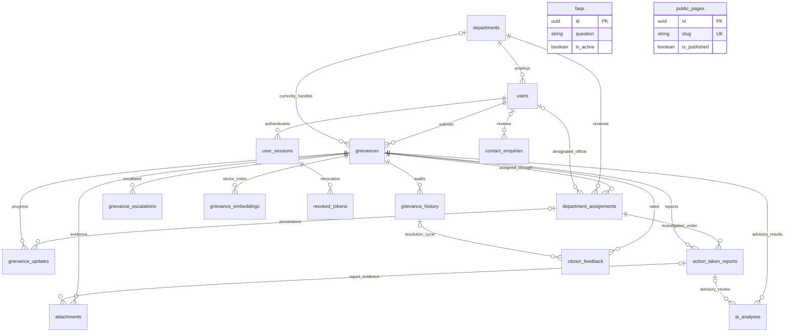

# Database Design

SQLAlchemy 2 typed ORM models and PostgreSQL are authoritative together with Alembic migrations. Application rows use UUID primary keys. Timestamps are interpreted in UTC. Supabase managed schemas remain separate from the application's `public` objects.

## Application tables

| Table | Main columns and relationships |
| --- | --- |
| `users` | name, unique email, mobile_number, password_hash, role, department_id FK, is_active |
| `departments` | unique name, description, is_active |
| `grievances` | unique reference_number, citizen_id FK, district, category, subject, description, status, priority, current_department_id FK, due_at, resolved_at |
| `grievance_history` | grievance_id FK, from_status, to_status, changed_by FK, remarks, remarks_visibility, created_at |
| `department_assignments` | grievance_id, department_id, officer_id, assigned_by FKs; assignment_note, assigned_at, closed_at |
| `grievance_updates` | grievance_id, author_id, assignment_id FKs; message, visibility |
| `action_taken_reports` | grievance_id, assignment_id, submitted_by, reviewed_by FKs; report_details, review_status, review_remarks, submitted_at, reviewed_at |
| `grievance_escalations` | grievance_id, escalated_by FKs; reason, previous/new due dates and priorities |
| `attachments` | grievance_id, optional report_id, uploaded_by FKs; storage_key/provider/bucket, original_filename, content_type, file_size |
| `citizen_feedback` | grievance_id, citizen_id, resolution_history_id, resolution_department_id FKs; rating, comments, reopen_requested |
| `contact_enquiries` | name, email, subject, message, status, reviewed_at, reviewed_by FK |
| `ai_analyses` | grievance_id, requested_by, optional report_id and suggested_department_id FKs; model_name, analysis_type, category/priority suggestions, summary, reasoning, JSONB result_data |
| `grievance_embeddings` | grievance_id FK, model_name, dimensions, Vector(768) embedding, source_fingerprint, updated_at |
| `user_sessions` | user_id FK, current_refresh_jti_hash, expires_at, last_used_at, revoked_at, revocation_reason |
| `revoked_tokens` | session_id FK, token_jti_hash, token_type, expires_at, revoked_at, reason |
| `faqs` | question, answer, display_order, is_active |
| `public_pages` | unique slug, title, introduction, JSONB sections, is_published |

`alembic_version` records schema revision and is not a business table. There are 17 application tables at head `0008`; vector-less revision `0007` omits `grievance_embeddings`.

## Relationships

The diagram emphasizes case relationships; actor FKs listed in the table above are omitted from several edges for readability. Legacy rows may have null provenance.

## Integrity and privacy

- Native enums constrain roles, official statuses, priorities, update visibility and report review states.
- Partial unique indexes allow only one open assignment and one pending report per grievance.
- Row locking and transactional services serialize assignments, report decisions, feedback and status changes. Every official status change inserts history in the same transaction.
- History and escalations are append-only; restrictive foreign keys and audit protections prevent destructive cascade cleanup.
- Feedback is unique per citizen/grievance/resolution event, with rating constraints. A later resolution cycle may receive new feedback; a feedback reopen request is not an automatic official reopen.
- Vector rows preserve model/dimension/source provenance. Retrieval rejects incompatible/stale inputs; embeddings are not anonymous and remain protected data.
- Citizen-facing serializers redact internal remarks and exclude unrelated records. Hosted tooling supports restricted application-object grants/RLS; the FastAPI runtime still enforces application authorization. Do not assume arbitrary database credentials provide least privilege.

## Migration graph

| Revision | Purpose |
| --- | --- |
| `0001` | Initial domain schema |
| `0002` | Authentication sessions and revocation |
| `0003` | History/privacy fields |
| `0004` | Administrative workflow integrity and escalation |
| `0005` | AI report provenance |
| `0006` | Optional pgvector embedding branch from `0005` |
| `0007` | Supporting features branch from `0005` |
| `0008` | Merge `0006` and `0007`; no additional DDL |

Use `alembic heads` and `alembic current` to inspect state. On a new vector-capable database, explicitly authorize `alembic upgrade head`; without vector, use `alembic upgrade 0007`. Never stamp a revision to conceal missing DDL, run migrations automatically at startup, or point destructive test fixtures at hosted records.
